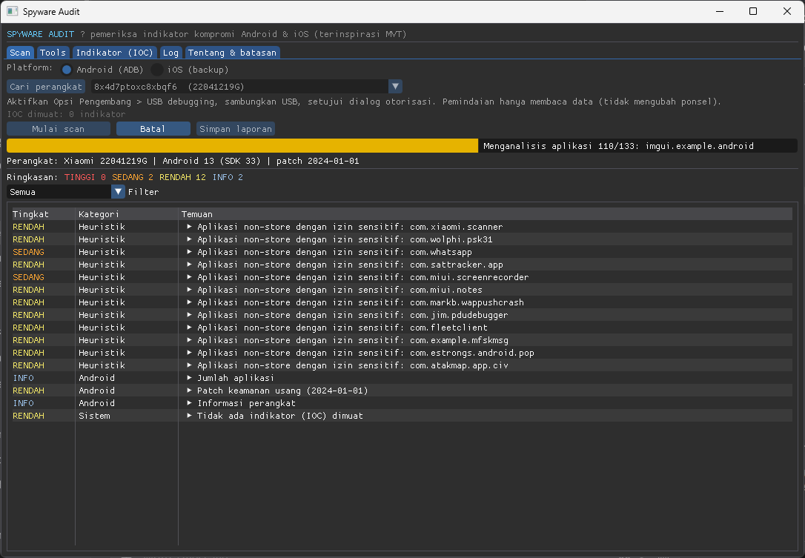

# MVT-GUI — Spyware Audit untuk Android & iOS

<p align="center">
  
</p>

<p align="center">
  
  
  
  
  
  
  
  
</p>

Alat desktop Windows (satu file `.exe`) untuk memeriksa tanda-tanda **spyware** pada perangkat **Android** dan **iOS**,
terinspirasi oleh [MVT — Mobile Verification Toolkit](https://github.com/mvt-project/mvt) buatan Amnesty International Security Lab.
Dibuat dengan C++17 dan Dear ImGui, dikompilasi memakai MSYS2.

Alat ini memakai format indikator kompromi (**IOC**) STIX2 yang sama dengan MVT, sehingga indikator publik
(Pegasus, Predator, dan lainnya) bisa dipakai langsung.

> ⚠️ **Hasil bersih BUKAN jaminan perangkat aman.** Lihat bagian [Batasan](#batasan).

---

## Fitur

**Android (via ADB, hanya membaca data — tidak mengubah ponsel)**
- Properti perangkat, tingkat patch keamanan, build `test-keys`/`debuggable`, deteksi binary `su` (root)
- Daftar paket, termasuk aplikasi yang **sudah dihapus** tetapi masih tercatat
- Pencocokan IOC: nama paket, hash SHA-256 APK, nama proses berjalan, jalur file
- Layanan aksesibilitas, notification listener, dan device admin yang aktif
- Heuristik: aplikasi non-store dengan izin sensitif (mikrofon, SMS, lokasi latar belakang, dll.)

**iOS (via backup lokal `idevicebackup2`, atau folder backup yang sudah ada)**
- `Manifest.db`: nama/jalur file yang cocok dengan IOC
- Riwayat Safari (`History.db`) dan tautan di SMS/iMessage (`sms.db`) dicocokkan dengan domain/URL IOC
- Nama proses di `DataUsage.sqlite`

**Umum**
- Tingkat temuan: **TINGGI** (cocok IOC), **SEDANG/RENDAH** (heuristik), **INFO**
- Tombol unduh IOC terbaru dari [`mvt-project/mvt-indicators`](https://github.com/mvt-project/mvt-indicators)
- Tombol unduh **adb** dan **alat iOS** otomatis ke folder `tools\` → cukup distribusikan `.exe`
- Ekspor laporan teks ke `reports\`
- Semua pemrosesan berjalan lokal

---

## Requirement

| Kebutuhan | Dipakai untuk |
|---|---|
| Windows 10 1803+ (ada `curl.exe` dan `tar.exe`) | Tombol unduh tools & IOC |
| GPU/driver yang mendukung DirectX 11 (fallback WARP otomatis) | Tampilan |
| Koneksi internet | Hanya saat mengunduh tools/IOC |
| **Android:** USB debugging aktif + otorisasi ADB disetujui di ponsel | Pemindaian Android |
| **iOS:** [Apple Devices](https://apps.microsoft.com/) (Microsoft Store) atau iTunes terpasang; ponsel dibuka kuncinya dan sudah *Trust* | Layanan Apple Mobile Device & driver USB |
| **iOS:** backup **tanpa enkripsi** + ruang disk cukup (sebesar isi ponsel) | Analisis backup |
| Windows 10 22H2 / 11 untuk unduhan alat iOS otomatis | `tar.exe` perlu mendukung `.zst` |

Alat eksternal (diunduh dari tab **Tools**, tidak disertakan di dalam exe):
- **adb** — [Android SDK Platform-Tools](https://developer.android.com/tools/releases/platform-tools) (dl.google.com)
- **libimobiledevice** (`idevice_id`, `ideviceinfo`, `idevicebackup2`) beserta DLL dependensinya — dari repositori paket MSYS2 (repo.msys2.org)

---

## Instalasi

1. Unduh `SpywareAudit.exe` dari halaman [Releases](https://github.com/YD1RUH/MVT-GUI/releases).
2. Taruh di folder mana saja (disarankan folder khusus, mis. `D:\SpywareAudit\`), lalu jalankan. Tidak perlu instalasi.
3. Folder `tools\`, `iocs\`, `backups\`, dan `reports\` dibuat otomatis di samping exe.

---

## Penggunaan

1. Jalankan `SpywareAudit.exe`.
2. Tab **Tools** → klik **Unduh semua** (adb + alat iOS). 
3. Tab **Indikator (IOC)** → klik **Unduh indikator terbaru**, atau taruh file `.stix2`/`.json` sendiri di folder `iocs\`.
4. Tab **Scan**:
   - **Android:** aktifkan *Opsi Pengembang → USB debugging*, sambungkan USB, setujui dialog otorisasi → **Cari perangkat** → **Mulai scan**.
   - **iOS:** sambungkan USB, buka kunci layar, ketuk *Trust* → **Cari perangkat** → pilih folder backup → **Mulai scan**
     (atau hilangkan centang *Buat backup baru* untuk menganalisis folder backup yang sudah ada).
5. Tinjau temuan, lalu **Simpan laporan** (tersimpan di `reports\`).

> 🔒 Backup iOS berisi data yang sangat sensitif (pesan, foto, kontak). Simpan di disk terenkripsi dan hapus setelah selesai.

### Struktur folder saat dijalankan

```
SpywareAudit.exe
├─ tools\     adb.exe, idevice*.exe, DLL   (diunduh dari tab Tools)
├─ iocs\      *.stix2 / *.json             (diunduh/diletakkan manual)
├─ backups\   backup iOS
└─ reports\   laporan hasil scan
```

---

## Batasan

- Alat ini mencari (1) kecocokan dengan IOC publik dan (2) heuristik sederhana. **Ia tidak membuktikan perangkat bersih.**
- Spyware tingkat negara sering memakai exploit *zero-click* dan menghapus jejaknya; backup/ADB bisa tidak memuat bukti apa pun.
- Backup iOS terenkripsi belum didukung (buat backup tanpa enkripsi atau dekripsi terlebih dahulu).
- Skema `DataUsage.sqlite` dan `sms.db` bisa berbeda antarversi iOS.
- Analisis `sysdiagnose` iOS dan `bugreport` Android belum tersedia — untuk kasus berisiko tinggi gunakan MVT resmi.

Bila ada temuan TINGGI pada orang berisiko (jurnalis, aktivis, pembela HAM), hubungi
[Access Now Digital Security Helpline](https://www.accessnow.org/help/) atau Amnesty Tech.

## Etika & hukum

Gunakan hanya pada perangkat **milik Anda sendiri** atau dengan izin tertulis pemiliknya.

## Kredit

- [MVT — Mobile Verification Toolkit](https://github.com/mvt-project/mvt) dan [mvt-indicators](https://github.com/mvt-project/mvt-indicators) (Amnesty International Security Lab) — inspirasi dan format indikator
- [Dear ImGui](https://github.com/ocornut/imgui) — MIT License
- [SQLite](https://www.sqlite.org/) — domain publik
- [libimobiledevice](https://libimobiledevice.org/) — LGPL (diunduh saat runtime, tidak disertakan)
- Android SDK Platform-Tools — milik Google (diunduh saat runtime, tidak disertakan)

Proyek ini tidak berafiliasi dengan Amnesty International maupun proyek MVT.
